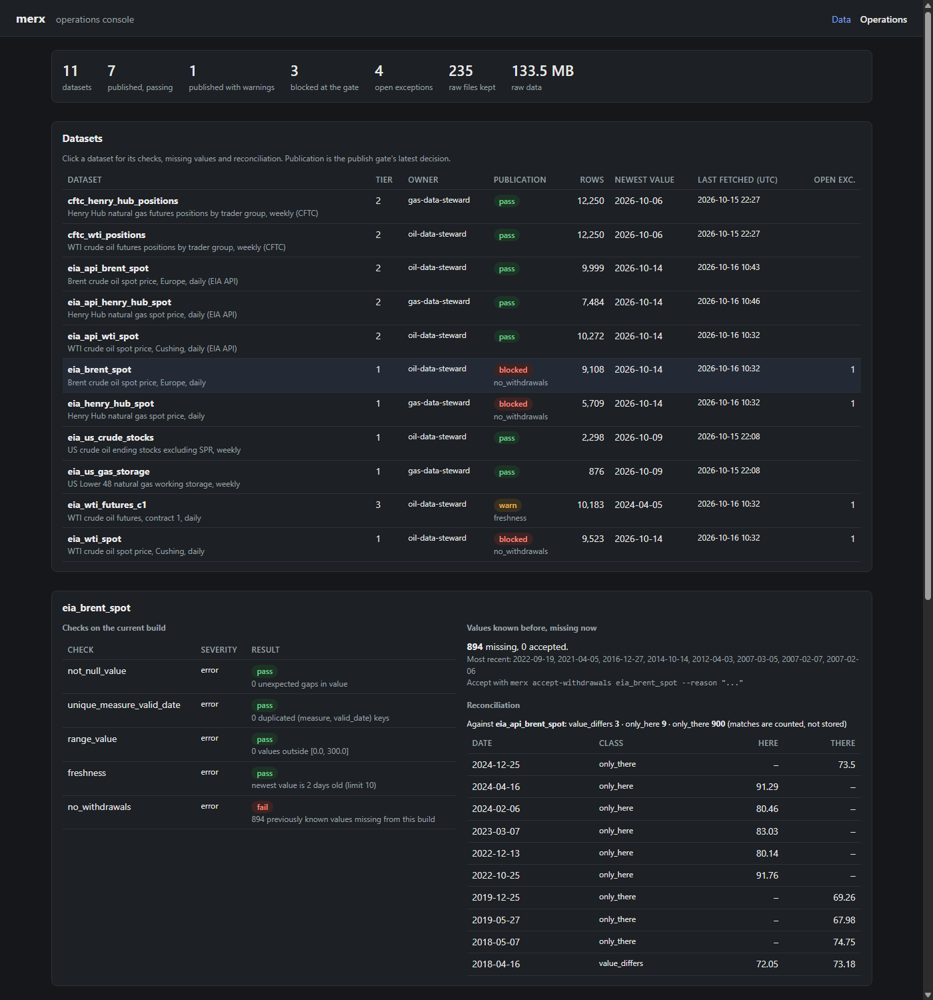
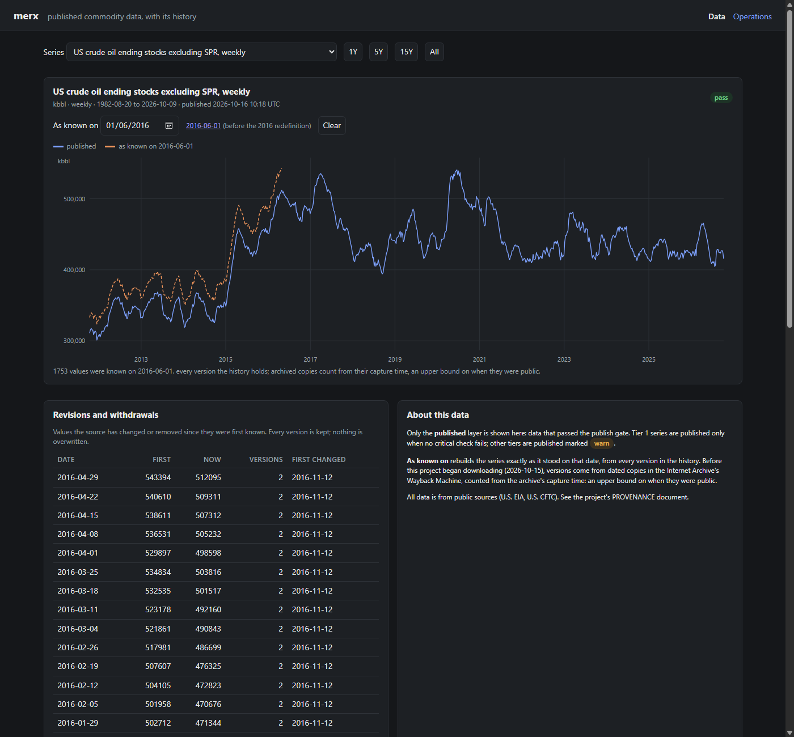
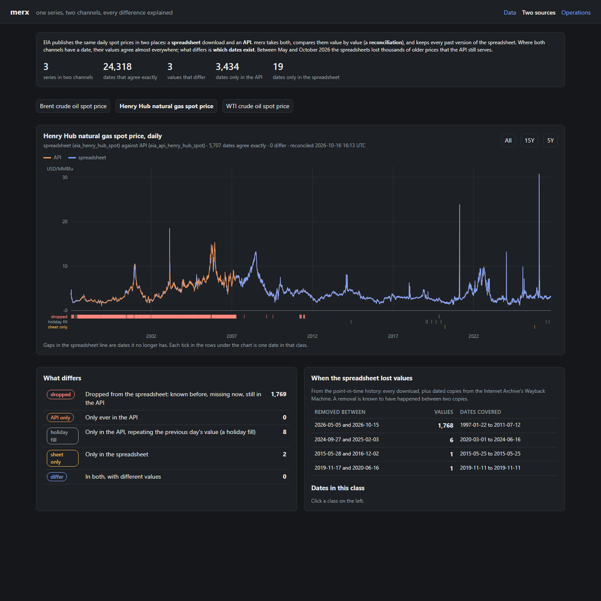

# merx

*merx* (Latin: "wares", "goods"): a commodities data operations platform, built
as a small, honest version of how commodity datasets are manufactured and kept
trustworthy.

> **Independent personal project.** Built entirely from public sources and synthetic
> data, on personal time and equipment. It contains no confidential, proprietary or
> employer information, and is not affiliated with, endorsed by, or derived from the
> work of any employer, client, data vendor or exchange. Fetched data is never
> committed, and every synthetic component is labelled as such. Sources, licences and
> what is deliberately *not* used: [`docs/PROVENANCE.md`](docs/PROVENANCE.md).

> **Status: running.** **29 real datasets from six public sources**, across all six
> sectors — oil, gas, power, carbon, metals and agriculture — run end to end through one
> engine (contract → raw download → staged table → checks → publish gate, orchestrated
> by Dagster). Failing checks become tracked exceptions with owners; every value keeps
> its full revision history; two sources for the same number are reconciled against each
> other; the data-quality lab scores anomaly detectors on the real series; and three
> consoles show it all. Adding a dataset is a contract file, not a pipeline.

## Consoles

**Live:** <https://merx.ambarshukla.dev/client>, <https://merx.ambarshukla.dev/sources> and
<https://merx.ambarshukla.dev/ops>, refreshed every day (`deploy/`, D-015). Locally:
`merx serve`, then open <http://127.0.0.1:8000/client>, <http://127.0.0.1:8000/sources>
and <http://127.0.0.1:8000/ops>.

**Operations** (`/ops`): every dataset's publication status, checks on the current
build, open exceptions with owners and root causes, values gone missing, reconciliation
breaks, and the detector scores.



**Data** (`/client`): published series only, with quality status, a note when newer
data is held back, and **"as known on"**: the series as it stood on any past date. Below,
US crude stocks as known on 2016-06-01 (dashed) against today: the 2016 redefinition
of the whole history.



**Two sources** (`/sources`): the three daily spot prices come through two channels, EIA's
spreadsheet and EIA's API. Both are drawn on one chart, every difference is classified,
and the history shows when the spreadsheet lost values. Below, Henry Hub: the red band is
1,768 prices (1997 to 2011) that the spreadsheet dropped in 2026 and the API still has.



## What runs today

| Dataset | Source | Frequency | Tier |
|---|---|---|---|
| WTI crude oil spot (Cushing) | EIA | daily | 1 |
| Brent crude oil spot | EIA | daily | 1 |
| Henry Hub natural gas spot | EIA | daily | 1 |
| US crude oil stocks excluding the SPR | EIA | weekly | 1 |
| US Lower 48 natural gas in storage | EIA | weekly | 1 |
| WTI crude oil futures, contract 1 | EIA | daily (series ended 2024-04-05) | 3 |
| WTI crude oil spot, second channel (EIA API) | EIA API | daily | 2 |
| Brent crude oil spot, second channel (EIA API) | EIA API | daily | 2 |
| Henry Hub natural gas spot, second channel (EIA API) | EIA API | daily | 2 |
| WTI futures positions by trader group (14 measures) | CFTC | weekly, yearly files from 2010 | 2 |
| Henry Hub futures positions by trader group (14 measures) | CFTC | weekly, yearly files from 2010 | 2 |

The positioning datasets also check an accounting identity every week: open interest
equals all long positions plus spreads, and all short positions plus spreads. It holds
in all 875 weeks since 2010 for both markets.

Each dataset is one YAML file in [`contracts/`](contracts/). A factory turns every
contract into three Dagster assets:

```
contracts/eia_wti_spot.yaml
        │
        ▼
raw/eia_wti_spot        download, keep the file untouched in data/raw/, record it in the manifest
        │
        ▼
staged/eia_wti_spot     parse strictly, rebuild staged."eia_wti_spot", then run the contract's
        │               checks on that build: not_null_value, unique_measure_valid_date,
        │               range_value, freshness, no_withdrawals, anomaly_*. Failures open exceptions
        │               (ops.exceptions).
        ▼
published/eia_wti_spot  the gate: tier 1 publishes only if no error-level check failed;
                        tiers 2 and 3 publish marked "warn". Every attempt is logged.
```

As of 2026-10-16, eight datasets publish. The futures series (tier 3) is marked `warn`
because its newest value is from April 2024 (root cause `source_discontinued`). **WTI,
Brent and Henry Hub spot are blocked** by `no_withdrawals`: EIA's spreadsheets for all
three dropped large parts of their older history between May and October 2026 (744,
890 and 1,768 daily prices), while EIA's API still serves them. Reconciling each
spreadsheet against the API (D-012) shows the channels agree on all but 3 of more than
24,000 shared values; the disagreement is about which dates exist. Nobody has accepted
the losses (root cause `source_data_error`).

Every staged table has the same long shape: one row per `(measure, valid_date)`, with
the value, its unit, our instrument identifier, and the raw file and fetch time it came
from. A single-series dataset has one measure (`price`, `stocks`, `working_gas`).

## Point-in-time history

Sources overwrite their files in place. `pit."<id>"` keeps every version of every value
with when it became known, rebuilt by replaying every raw download; for five datasets
the history is backfilled from dated copies in the Internet Archive's Wayback Machine
(back to 2010). Any dataset can be rebuilt *as known at* any moment. What it found:

- US crude stocks: in 2016 the entire weekly history back to 1982 was revised down by
  15.7 to 34.1 million barrels.
- US gas storage: seven weekly values revised (2017, 2021, 2024).
- WTI, Brent and Henry Hub spot: between May and October 2026, **3,402 daily prices
  (744, 890 and 1,768) disappeared from EIA's spreadsheets** while EIA's API still
  serves them. No check on the rows present could see this; the history did.
- Henry Hub: in 2013, 57 prices were rounded from three decimals to two.

Details: [`docs/BUILD_LOG.md`](docs/BUILD_LOG.md), decision D-010.

## The data-quality lab

Which detectors actually catch bad data, and at what cost in false alarms? The lab
seeds five kinds of synthetic error into copies of the real series, runs the
detectors, and scores every flag against a ground-truth list. Headline from the
2026-10-15 run (six series, five seeds, 1,075 seeded defects):

| Detector | Recall | Precision | Alerts per year on real data |
|---|---|---|---|
| Static band (20% move) | 64% | 50% | 0.6 |
| Robust z-score, first version | 71% | 55% | 4.8 |
| Robust z-score, fixed after the first run | 70% | 72% | 3.9 |
| Seasonal + repeated-value rule | 87% | 87% | 2.4 |

Method, predictions against results, findings and limits:
[`docs/DQ_LAB.md`](docs/DQ_LAB.md).

## Run it

Needs Python 3.14.

```sh
python -m venv .venv
.venv/Scripts/pip install -e ".[dev]"      # .venv/bin/pip on macOS and Linux
.venv/Scripts/pytest                        # no network needed
.venv/Scripts/dagster dev                   # UI at http://localhost:3000
```

In the UI, open **Assets** and choose **Materialize all** to download and stage every
dataset (about 2 MB). Downloads go to `./data` (set `MERX_DATA_DIR` to change it);
set `DAGSTER_HOME` to an absolute path to keep run history between sessions.

The `merx` command covers what a person does by hand:

```sh
merx exceptions                                  # open exceptions first, with owners
merx assign-root-cause 2 source_data_error --note "..."
merx missing eia_wti_spot                        # values known before, missing now
merx accept-withdrawals eia_wti_spot --reason "..."
merx revisions eia_us_gas_storage
merx as-known-at eia_us_crude_stocks 2016-06-01  # the dataset as it stood then
merx backfill cftc_wti_positions --from 2010     # older partitions, then one rebuild
merx serve                                       # the consoles, on port 8000
```

## Layout

| Path | What it holds |
|---|---|
| `contracts/` | One YAML contract per dataset |
| `reference/` | Instruments, units, and the crosswalk from provider codes to our identifiers |
| `src/merx/contracts/` | The contract schema and loader |
| `src/merx/sources/` | Downloading, and one strict parser per file format (EIA spreadsheets, CFTC yearly zips) |
| `src/merx/store/` | The raw zone and its manifest; the DuckDB connection |
| `src/merx/engine/` | Staging, checks, the publish gate, exceptions and point-in-time history, as plain functions |
| `src/merx/quality/` | The data-quality lab: seeded defects, detectors, scoring |
| `src/merx/orchestration/` | Dagster: the asset factory, resources, schedules |
| `src/merx/api/` | The consoles: a read-only FastAPI app and two plain HTML pages |
| `deploy/` | The hosted deployment: compose file, daily timer, how to install and update |
| `tests/` | Tests on synthetic files generated at test time |

## What it will be

One shared engine that turns declarative **dataset contracts** into controlled
pipelines (land raw, stage, validate, enrich, publish, monitor), plus a console
for running them. The goal is that onboarding a new dataset is configuration,
not a new pipeline.

- **Real public data**: oil and gas prices and curves, weekly fundamentals,
  positioning, metals and agricultural series, GB power prices, carbon
  intensity. Fetched on demand; vendor data is never committed.
- **Controls as code**: completeness, timeliness, range, jump, stale and
  cross-series checks; a publish gate by tier; exceptions kept as data with
  root-cause classes.
- **A data-quality lab**: seeded defects with a ground-truth manifest, and
  detectors scored on precision and recall.
- **Point-in-time history**: every value carries when it applied and when it
  was learned, so any past view can be rebuilt as it was known.
- **Legacy re-engineering**: a deliberately fragile synthetic estate, ported
  with a parallel run in which every difference is explained.

Synthetic parts (the legacy estate, injected defects, the full forward curve)
are labelled as synthetic wherever they appear.

## Working agreements

Trunk-based development: short-lived branches, pull requests, protected `main`,
tests and CI from the first commit, decisions recorded in
[`docs/DECISIONS.md`](docs/DECISIONS.md), terms in
[`docs/GLOSSARY.md`](docs/GLOSSARY.md), history in
[`docs/BUILD_LOG.md`](docs/BUILD_LOG.md).

## Licence

MIT. See [`LICENSE`](LICENSE).
